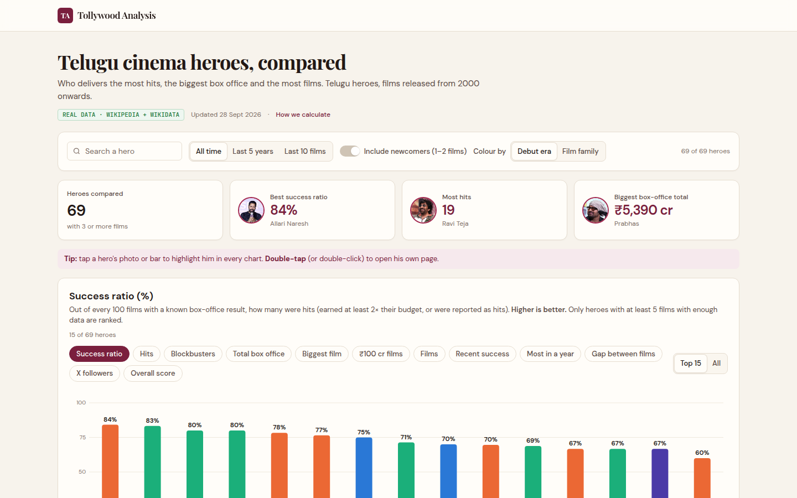

# Tollywood Analysis

A dashboard-first benchmarking app for Telugu-cinema **heroes and directors**: named leaderboards (**Tolly Index** and **Star Score**), a 2000–present Telugu **Releases** archive, release-cadence and audience charts, a labelled performance scatter, a sortable table, side-by-side comparison, and a separate **Annexure** with film-level evidence, methodology, sources, coverage, change log and a correction workflow.



> **Real data is on by default.** The app ships a snapshot built from **Wikipedia** (filmographies, release dates, budgets, worldwide grosses, box-office verdict sentences) and **Wikidata** (identifiers, runtimes, languages, recorded X follower counts). Tracks **89 active roster heroes** (Telugu heroes plus major Tamil, Malayalam, and Kannada stars whose films released in Telugu — originals, bilinguals, or Telugu dubs) and **593 Telugu-cinema directors** across films released from **1 January 2000** onward. Every number links back to its source. Lead roles are auto-classified from billing order and are marked *pending editorial check*; use the correction form if one is wrong.
>
> Set `NEXT_PUBLIC_DATA_MODE=demo` for the old synthetic dataset (marked `DEMO DATA`), or `live` to read Postgres.

---

## 1. See it running (no setup)

The production publication runs on **Cloudflare Workers** at **[https://tollyanalysis.com](https://tollyanalysis.com)** (and `https://www.tollyanalysis.com`), packaged with `@opennextjs/cloudflare` (`opennextjs-cloudflare`), deployed via Wrangler (`wrangler.jsonc`) with the bundled real-data snapshot (`NEXT_PUBLIC_DATA_MODE=real`), and continuously tested & deployed from `main` via GitHub Actions (`.github/workflows/deploy.yml`) with post-deploy IndexNow submission (`scripts/indexnow-ping.mjs`).

To build, preview, or deploy the Cloudflare Worker bundle:

```bash
npm run cf:build     # Compile Next.js App Router output into .open-next/worker.js and .open-next/assets
npm run preview      # Build and preview locally in the Cloudflare workerd runtime
npm run deploy       # Build and deploy to Cloudflare Workers (or run: npx wrangler deploy)
```

To run the Next.js development server locally (Node 20.9+):

```bash
npm install
npm run dev          # http://localhost:3000
```

## 2. What is in the app

A top navigation (`Home`, `Tolly Index`, `Star Score`, `Heroes`, `Directors`, `Releases`, `Rankings`, `Compare`, `Trends`, and `How it works`) and **one scrolling overview page**: cinema banner with the top three heroes → filters → headline numbers → photo leaderboard (**Star Score** by default; success ratio, hits, blockbusters, total box office, plus "More measures") with tie-aware ranks → top-5 lists → career atlas → "Go deeper": two **Pareto (best trade-off) charts** with changeable axes and a "find a hero" list, plus collapsible box-office, release-pace, recent-form and career-reach sections → "Every hero, every metric" table with CSV → **"How we calculate everything"** and "About this snapshot".

- Bars are coloured by **debut era** or by **film family** (Mega, Nandamuri, Akkineni, Daggubati, Ghattamaneni, Manchu, other); switch with *Colour by*, and tap a legend item to hide a group.
- Every bar, dot and table row shows the hero's photo (free-licensed, from Wikimedia Commons; initials when none exists).
- **Tap** a hero to highlight him everywhere; **double-tap / double-click** to open his own page (`/hero/<name>`): banner with his headline numbers, the **Star Score part by part**, highlights, career milestones, results bar, year-by-year chart, comparison against the median hero, every statistic with his rank, and a large sortable table of every film (result with its source, worldwide gross, budget, gross ÷ budget, director, music, runtime, genre, language, billing) where each row opens its evidence; plus the appearances that were not counted and why. `/heroes` lists every hero as a card.
- Ratios and averages only rank heroes with at least 5 judged films (and directors with at least 4 judged films), so a newcomer with a small sample cannot top the chart.

| Page | What it shows |
|---|---|
| `/` | Home dashboard (leads with the Tolly Index when enabled, or the Star Score overview) |
| `/tolly-index`, `/star-score` | Dedicated Tolly Index and Star Score leaderboards & career dashboards |
| `/heroes`, `/hero/<slug>` | Full hero directory and per-hero career & filmography evidence pages |
| `/directors`, `/director/<slug>` | Director hit-rate leaderboard and 593 per-director Telugu filmography pages |
| `/releases` | Year-by-year archive of 3,376 Telugu feature releases since 2000 |
| `/compare`, `/trends`, `/rankings` | Side-by-side comparison, career trends, and sortable rankings |
| `/methodology` | Every formula, weight and threshold, plus what is deliberately excluded |
| `/annexure/…` | Film-level evidence: registry, per-hero evidence, sources, coverage, change log, corrections, photo credits |
| `/careers`, `/contact`, `/terms`, `/privacy` | Editorial/data roles, contact information, terms of use, and privacy policy |
| `/admin` | Editorial admin (sign-in with `ADMIN_TOKEN`) |

### Fans' ranking (off by default)

Visitors pick their top three heroes (3/2/1 points), one ballot per device (httpOnly cookie; voting again replaces the ballot). To switch it on, set `NEXT_PUBLIC_FEATURE_USER_RANKING=true` and redeploy. Votes are stored in the `user_rankings` table when `DATABASE_URL` is set; without a database they live in server memory and reset on restart.

### Hero photos

`npm run photos:fetch` downloads the lead portrait of each hero's English Wikipedia article **only if it is hosted on Wikimedia Commons** (free licence), saves it to `public/heroes/`, and records author, licence and file page in `lib/data/hero-photos.json` (shown on `/annexure/photo-credits`). Non-free images are skipped.

## 3. Where the real data comes from

`npm run data:import` rebuilds `lib/data/real/snapshot.json` (cached under `.cache/import`, gitignored):

1. Exports each hero's Wikipedia article and "… filmography" page via `Special:Export` (bulk, polite, no HTML scraping) and parses the film tables. TV, web series, songs, cameos, voice roles, re-releases, unreleased and non-Telugu titles are dropped.
2. Exports every film article and reads the infobox (release date, language, director, music, runtime, budget, gross).
3. Enriches from Wikidata SPARQL: release dates (P577), languages, genres, runtime, IMDb ids (links only), hero portraits (P18) and follower counts (P8687, split by qualifier into X / Instagram / YouTube).
4. Keeps a credit only if the hero is billed first, or second/third right after another roster hero (co-lead). Character actors use strict billing. Supporting, antagonist and extended-cameo parts that slip through (e.g. Allari Naresh in *Maharshi*) are removed in `lib/constants/editorial.ts`, with the reason shown on the hero page.

**Each film's result** comes from the first source that states one (`lib/import/verdict.ts`, `lib/import/trade-blog.ts`):

| Order | Source | Films (current snapshot) |
|---|---|---|
| 1 | The film's English Wikipedia article: box-office section first, then lead, then reception (plot, cast, music, awards skipped; quotes, critics, remakes, other films and speculation ignored; "was not a success" reads as a flop) | 755 |
| 2 | Editor check against trade reports or news articles (every film links its citation) | 152 |
| 3 | The hero's English Wikipedia article ("commercial successes such as *Kithakithalu*, *Gamyam*…"; contrasting clauses read separately) | 62 |
| 4 | The film's Telugu Wikipedia article (విజయవంతమైంది, ఫ్లాప్, negations) | 19 |
| 5 | mtwikiblog.com yearly and per-hero "hits and flops" lists — **low confidence**, used only when Wikipedia and editor checks are silent | 279 |

Of **1,688** counted films across 89 active roster heroes, **1,267 (75%) have a verdict**, **27** without a verdict are direct-to-OTT (28 OTT counted films total), **4** are too recent (released in the last 120 days before snapshot) and **390** smaller films are "not reported" anywhere we read — they are never counted as flops. Every film row on a hero's page names its source and links to it.

**Star Score.** One number out of 100 combining every KPI (`lib/calculations/star.ts`): success ratio 20%, hit films 15%, total box office 15%, blockbusters 10%, recent success 10%, social reach 10%, biggest film 5%, box office per film 5%, films as lead 10% (+ fans' votes 5% when the fans' ranking is on). Counts and money are percentile ranks among heroes; ratios are blended toward the typical hero for small samples; social reach is X + Instagram on a log scale. Missing parts are left out (weight shared out), money parts need ≥ 3 films with a reported gross, and the score is withheld below 50% weight coverage.

**Known limits.**
- Audience ratings need a free TMDb key (`FEATURE_TMDB`). IMDb is never scraped.
- X followers: Wikidata (45 active heroes). Instagram: one dated press report (`lib/data/real/reported-social.ts`, 6 heroes) until the Meta Graph API is configured. Instagram is never scraped.
- About **35%** of counted films (589 of 1,688) have a reported gross; totals are "as reported", not complete trade figures.
- **6** active heroes have no free-licensed portrait on Commons and show initials (Tarun, Sivaji, Suhas, Taraka Ratna, Srihari, Mouli Tanuj Prasanth). A TMDb key would allow attributed profile photos.

## 4. Go live with a database (Supabase)

1. **Create a Supabase project** at [supabase.com](https://supabase.com). Copy **Project Settings → Database → Connection string → URI**. For serverless/edge workers on Cloudflare Workers, use the *Transaction pooler* URI (port 6543).
2. **Set environment variables** (Cloudflare Worker secrets via `wrangler secret put` / Cloudflare Dashboard, or `.env.local` locally). See [`.env.example`](.env.example):
   - `DATABASE_URL` = your connection string
   - `ADMIN_TOKEN` = a long random string (`node -e "console.log(require('crypto').randomBytes(32).toString('hex'))"`)
   - `NEXT_PUBLIC_DATA_MODE` = `live` (keep `real` until the database has data)
3. **Create tables and seed the roster.** From any machine with Node, or from Claude Code:
   ```bash
   DATABASE_URL="postgres://…" npm run db:migrate
   DATABASE_URL="postgres://…" npm run db:seed          # sources, methodology, curated roster (no films)
   # or, to test live mode end-to-end with fictional films first:
   DATABASE_URL="postgres://…" npm run db:seed:demo     # later: npm run db:seed -- --purge-demo
   ```
4. **Turn on row-level security:** paste [`db/supabase/rls.sql`](db/supabase/rls.sql) into the Supabase SQL editor and run it. Public keys can then read only approved/public rows, and correction submissions stay private.
5. **Redeploy.** Sign in at `/admin`, add verified credits and evidence in the **Data console** (JSON or CSV), then press **Recalculate**.

Live mode shows the latest calculation timestamp, methodology version and confidence. It hides heroes whose evidence is insufficient.

## 5. Adding data (admin)

All writes are validated with Zod, audited in `change_log`, and need `DATABASE_URL`. Browser use: `/admin/data`. Scripts can call the same routes with `Authorization: Bearer $ADMIN_TOKEN`.

| Route | Purpose |
|---|---|
| `POST /api/admin/people` | Create/update a person |
| `POST /api/admin/films` | Create/update a film and its Telugu release (original or dub, theatrical or OTT) |
| `POST /api/admin/credits` | Approve a principal / co-principal lead credit (or reject a cameo etc.) |
| `POST /api/admin/source-claims` | Commercial/platform claim or manual IMDb/TMDb rating. JSON, or `text/csv` for bulk |
| `POST /api/admin/social-snapshots` | Official-profile follower snapshot (manual, or fetched when that provider is enabled) |
| `POST /api/admin/import/tmdb` | Import TMDb credits as **pending** candidates. Lead status is never inferred from cast order |
| `POST /api/admin/recalculate` | Recompute and persist hero/film snapshots |
| `POST /api/admin/corrections/:id/review` | Approve / reject / request evidence. Approval needs an explicit data action and triggers recalculation |

Public read API: `GET /api/heroes`, `/api/heroes/:slug`, `/api/heroes/:slug/metrics?window=`, `/api/heroes/:slug/films?page=`, `/api/rankings?metric=&window=&includeEmerging=`, `/api/compare?heroes=a,b`, `/api/methodology/current`, `/api/annexure/sources`, `/api/export/heroes` (CSV). `POST /api/corrections` is rate-limited. Every metric response carries its coverage and methodology version.

## 6. Data providers and policy

| Provider | Default | Notes |
|---|---|---|
| TMDb | off (`FEATURE_TMDB`) | Primary metadata/credits. Attribution shown in the footer and Source Ledger. Commercial use needs a licence review |
| IMDb | **disabled** | Only via a licensed or permitted source (`FEATURE_IMDB_LICENSED`). Never scraped. Manual entry with source URL is allowed |
| Instagram / X / YouTube / Facebook | off | Official profiles only, with snapshot date. Shown as *Verified Public Social Reach*, never "fans" |
| Wikidata | optional | Identifier reconciliation only |
| Box office / OTT | editorial | Multiple claims per film, conflict detection (>15% difference = disputed), approval workflow. No scraping |
| BookMyShow | not used | No public official API |

Provider calls are server-side only, with timeouts, exponential backoff, `Retry-After` handling and per-provider kill switches.

## 7. Methodology in one screen

- **Eligibility:** verified principal or co-principal male lead; feature films from 1 Jan 2000; original Telugu **or** an identifiable Telugu dub; theatrical and direct-to-OTT features count. Excluded: cameos, supporting and special appearances, voice-only roles, re-releases, series, shorts, anthology segments and YouTube films. A genuine multi-hero film counts for each lead.
- **Film Success Score** = 0.35 Audience + 0.35 Commercial/Platform + 0.20 Evidence Quality + 0.10 Legacy. Missing parts are never zero: their weight is redistributed and the film becomes `provisional`, `insufficient_evidence` or `not_yet_final`.
- **Audience:** Bayesian `(v/(v+m))·R + (m/(v+m))·C`, film-wide (never Telugu-audience-only).
- **Dubbed titles:** an all-language gross is never credited to the Telugu version. It stays *unknown*.
- **Hero Performance Index** = 0.35 Film Success + 0.25 Audience + 0.15 Consistency + 0.15 Social Reach + 0.10 Momentum. It is a transparent, versioned benchmark, not fact.
- **Cadence KPIs:** median release gap (lower is better), peak films in a calendar year, films per active year.
- **Critic reviews are excluded in v1.** The roster excludes Panja Vaisshnav Tej by editorial decision.

## 8. Development

```bash
npm run lint         # ESLint
npm run typecheck    # route types + tsc
npm run test         # Vitest: calculations, engine rules, DB round-trip (PGlite), validation, providers
npm run test:e2e     # Playwright: desktop + mobile flows and no-overflow checks
npm run build
npm run check        # lint + typecheck + test + build
```

Set `CHROMIUM_PATH=/path/to/chrome` to run Playwright with a preinstalled browser.

```
app/                 pages (home, tolly-index, star-score, heroes, directors, releases, rankings, compare, trends, methodology, annexure, careers, contact, admin) and API routes
components/          charts (ranked bars, labelled scatter with d3-force labels, year charts), dashboard, directors, releases, annexure, admin, ui
lib/calculations/    pure, unit-tested scoring engine (Bayesian rating, film score, hero indices, cadence, confidence)
lib/data/real/       bundled Wikipedia + Wikidata snapshot and its loader
lib/data/releases/   2000–present Telugu feature release archive
lib/data/demo/       deterministic synthetic demo dataset (fictional titles only)
lib/import/          wikitext, money and verdict parsers used by the importer
lib/providers/       TMDb, IMDb (disabled), Instagram, X, YouTube, Facebook, Wikidata adapters
lib/repositories/    demo/live data access, corrections store
lib/seo.ts           canonical metadata and Schema.org JSON-LD graph builders
db/schema, db/migrations, db/supabase/rls.sql, db/repository.ts, db/admin.ts
scripts/             data:import, photos:fetch, db:migrate, db:seed, db:recalculate, indexnow-ping.mjs
tests/unit, tests/e2e
```

Stack: Next.js 16 (App Router), TypeScript strict, Tailwind CSS 4, OpenNext Cloudflare (`@opennextjs/cloudflare`), Wrangler 4, Drizzle ORM + Postgres (Supabase), Zod, TanStack Table, React Hook Form, d3-force, Vitest, Playwright, GitHub Actions.

## 9. Known gaps / next steps

- Admin sign-in uses a single `ADMIN_TOKEN` session (httpOnly signed cookie). Switching to Supabase Auth user accounts is the planned next step; RLS already blocks public writes.
- The public correction rate limit is in-memory (per Worker isolate). Use a shared store if you scale out.
- 6 active heroes have no free-licensed portrait yet and show initials. Adding a properly licensed photo (for example via TMDb once licensed) fixes that.
- Lead-role classification is automatic; review it in the admin console and add overrides to `lib/constants/editorial.ts`.
- Directors are live (`/directors` and `/director/[slug]`); heroines and comedians are not built yet, though the database schema (`people`, `role_scope`) is ready for them.
