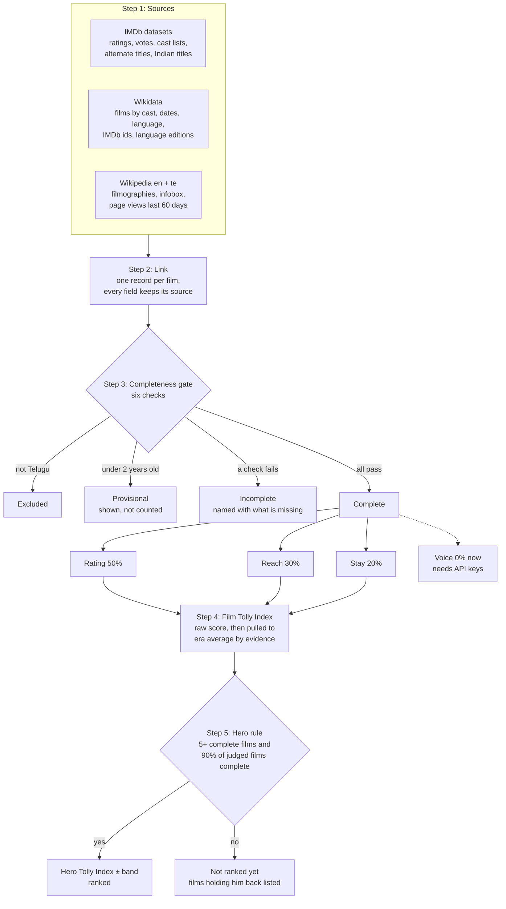
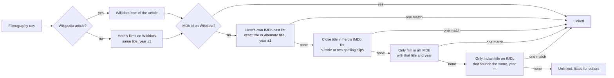
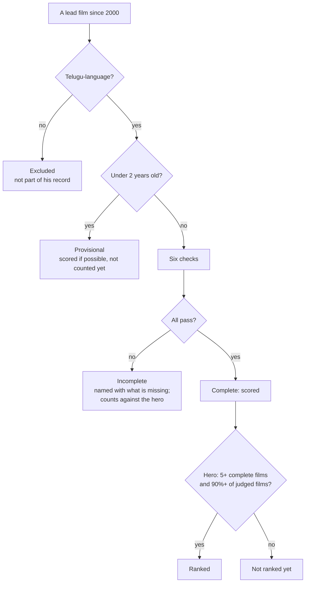
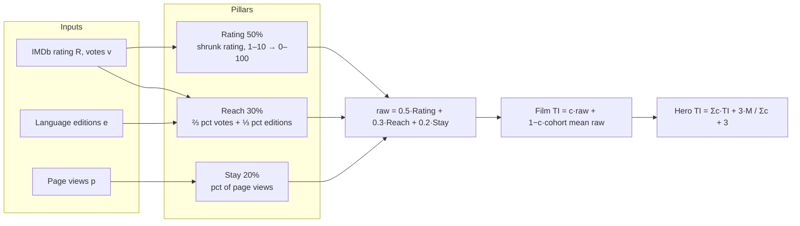

# The Tolly Index: how it is calculated

*Method version: tolly-v1.1. Data as of 15 October 2026. Code: `lib/tolly/`, `scripts/tolly/`. Results: `lib/data/tolly/`.*

---

## Contents

1. [In one sentence](#1-in-one-sentence)
2. [The three rules](#2-the-three-rules)
3. [The whole pipeline](#3-the-whole-pipeline)
4. [Data sources we use](#4-data-sources-we-use)
5. [Linking every film across sources](#5-linking-every-film-across-sources)
6. [The completeness gate](#6-the-completeness-gate)
7. [The formula, step by step](#7-the-formula-step-by-step)
8. [Worked example: one film, one hero](#8-worked-example-one-film-one-hero)
9. [What the index produces](#9-what-the-index-produces)
10. [Results](#10-results)
11. [Checks that the index is right](#11-checks-that-the-index-is-right)
12. [Money: budget, inflation and ticket prices](#12-money-budget-inflation-and-ticket-prices)
13. [Sources we do not have access to](#13-sources-we-do-not-have-access-to)
14. [What is still missing](#14-what-is-still-missing)
15. [How to rerun it](#15-how-to-rerun-it)
16. [Glossary](#16-glossary)

---

## 1. In one sentence

> **The Tolly Index scores every Telugu hero's films from 0 to 100 on three things: what audiences thought of each film, how many people cared, and whether people still care today. It never uses money, and it compares each film only with films from its own time.**

Each hero then gets one number: the evidence-weighted average of his films, with a ± range.

---

## 2. The three rules

| Rule | What it means | Why |
|---|---|---|
| **1. No money** | No rupee figure (budget, gross, share) enters the index. | Box office is distorted by inflation and ticket prices, and reported figures are often disputed. Rupees from 2005 and 2024 are not comparable. |
| **2. Same era only** | Anything that grows with the internet (votes, readers) is compared only with films released within one year of the film. Opinions (ratings) use one scale for every year. | Online counts grow every year. A 2004 film with 3,000 voters may have been far more popular than a 2024 film with 40,000. |
| **3. No data, no score** | A film is scored only when every input the formula uses is present and checked. A hero is ranked only when at least 90% of his films are complete. | A missing number is never replaced with an average or a guess. Gaps are shown by name. |

---

## 3. The whole pipeline



| Step | Script | What it does |
|---|---|---|
| Filmographies | `npm run data:import` | Reads each hero's Wikipedia filmography, checks lead billing, builds `lib/data/real/snapshot.json` |
| Wikidata | `npm run tolly:wikidata` | Hero IMDb ids; every film listing a hero as cast; dates, language, IMDb ids, language editions |
| IMDb ratings | `npm run tolly:imdb` | Joins IMDb ratings and vote counts; unique title-and-year matches |
| IMDb cast | `npm run tolly:cast` | Streams IMDb's cast file (786 MB) and alternate titles (517 MB) for our 71 heroes |
| Link | `npm run tolly:link` | One record per film with the source of each field |
| IMDb extra | `npm run tolly:extra` | Actor billing order; search of every Indian title on IMDb for still-unlinked films |
| Page views | `npm run tolly:pageviews` | Daily Wikipedia views for the last 60 days, English + Telugu |
| Compute | `npm run tolly:compute` | Gate, pillars, film index, hero index; writes `lib/data/tolly/` |

`npm run tolly:all` runs all of these in order (about 40 minutes, mostly waiting on Wikipedia's rate limit).

---

## 4. Data sources we use

All sources are official and free: published datasets or public APIs. Nothing is scraped from a website whose terms forbid it.

| Source | Licence | What we take | Feeds |
|---|---|---|---|
| **Wikipedia filmographies** (English) | CC BY-SA | Each hero's films, roles, billing order | Which films count for a hero |
| **IMDb non-commercial datasets** | Personal / non-commercial use | `title.ratings` (rating, votes), `title.basics` (title, year, runtime, genres), `title.principals` (cast and billing order), `title.akas` (alternate and Indian titles) | Rating, Reach, linking |
| **Wikidata** (query service) | CC0 (public domain) | Films by cast member, release dates, original language, IMDb ids, number of Wikipedia language editions, hero IMDb ids and birth dates | Linking, Reach, gate |
| **Wikipedia page views** (MediaWiki API) | CC0 data | Daily views of each film's English and Telugu article, 14 Aug – 12 Oct 2026 | Staying power |
| **Critics' scores quoted in Wikipedia** | CC BY-SA | "Rated 3.5/5" style scores in reception sections | Cross-check only |
| **MovieLens 32M** (GroupLens) | Research, non-commercial | 32 million ratings; 207 of our films | Cross-check only |

**Coverage of the data the formula needs (1,297 unique lead films since 2000):**

| Data | Have it |
|---|---|
| IMDb title linked | 1,262 |
| IMDb rating with 10+ votes | 1,204 |
| Wikidata item | 1,188 |
| Release year confirmed by a second source | 1,261 |
| Exact release date | 1,183 |
| Original language known | 1,297 |
| Language editions (0 when no article: 109 films) | 1,297 |
| Page views (0 when no article: 110 films) | 1,297 |

**Hero data (71 heroes):** IMDb person id 71/71; birth date 70/71; career start 70/71; free-licence photo 63/71. Follower counts on X and Instagram are context only and not part of the index.

> **Licence note.** IMDb and MovieLens are licensed for non-commercial use only. The repository therefore stores only our derived scores. Raw IMDb ratings and vote counts stay in a local cache that git ignores. A commercial launch needs an IMDb licence, or other rating sources (TMDB, Letterboxd) under their own terms.

---

## 5. Linking every film across sources

Every film must be the same film in every source. A wrong link would give a film another film's rating. Links are only ever made **within the same hero's films, one year either side**, and only when exactly one candidate fits.



**Title matching** (`lib/tolly/match.ts`) handles Telugu romanisation:

- **Exact key:** lower case, no qualifiers like "(2006 film)", letters and digits only.
- **Sound key:** folds aspirates (th→t, dh→d, bh→b), long vowels (aa→a, ee→i, oo→u), doubled letters, w→v, z→s, y→i. So "Kithakithalu" = "Kitakitalu" and "Chatrapathi" = "Chhatrapati".
- **Loose match** (last resort, still within the hero's films): a subtitle ("Bhairava" / "Bhairava IPS") or up to two slips in a long title ("Amaravathi" / "Amavarathi").

**Duplicates.** When two filmography rows resolve to the same IMDb title, for example "RRR" and "RRR (film)", they become one film and both heroes are credited. 8 such pairs were merged.

**How each link was made:**

| Method | Films |
|---|---|
| IMDb id on the film's Wikidata item | 1,163 |
| Hero's IMDb cast list, exact title | 71 |
| Unique title and year in all of IMDb | 18 |
| Unique Indian title on IMDb (sound-alike, year ±1) | 7 |
| Hero's IMDb cast list, close title | 3 |
| Not linked | 35 |

---

## 6. The completeness gate



### The six checks: one for each input the formula uses

| # | Check | Protects |
|---|---|---|
| 1 | IMDb title found | Rating, Reach |
| 2 | At least **10** IMDb votes | Rating, Reach |
| 3 | Release year confirmed (± 1) by Wikidata or IMDb | Era cohort |
| 4 | Number of Wikipedia language editions known (0 if none) | Reach |
| 5 | Page views known (0 if no article) | Staying power |
| 6 | Exact release date, **only** when the year alone cannot settle the 2-year rule | Age |

**Why 10 votes and not 100?** The formula already discounts thin evidence twice:

- the rating is pulled toward the era average in proportion to how few voted;
- the film's weight in its hero's index shrinks with its confidence.

At 10 votes, about 97% of the shrunk rating is already the era average. Below that there is no measurement left, so the film is not scored.

**Why a film with no Wikipedia article gets 0 views and 0 editions.** Nobody has written about the film, so nobody can be reading about it: zero is the measured value, not a gap. We record it only after both Wikidata and the IMDb cast lists have been searched for an article.

### Film statuses

| Status | Meaning | Count |
|---|---|---|
| Complete | All six checks pass, at least 2 years old | **1,109** |
| Provisional | Under 2 years old (even if a check fails) | 85 |
| Incomplete | At least one check fails | 88 |
| Excluded | Not a Telugu-language film | 15 |
| **Total** | Unique lead films since 2000 | **1,297** |

### The hero rule

A hero is ranked when he has **at least 5 complete films** and **at least 90% of his judged films are complete**. Judged films are those at least 2 years old, excluding non-Telugu films. One hero can no longer be ranked on his famous films while half his career is missing.

---

## 7. The formula, step by step



### Step 1: the era cohort

The **cohort** of a film is every scorable film released within one year of it (year − 1 to year + 1): complete films plus provisional films with full data. Cohorts hold 70–176 films. From the cohort we take:

- **m**: the median IMDb vote count;
- **C**: the mean IMDb rating;
- **the mean raw score**, used in step 6.

### Step 2: Rating (50%), "Did people like it?"

$$R' = \frac{v}{v+m}\,R + \frac{m}{v+m}\,C \qquad \text{Rating} = \frac{R' - 1}{9} \times 100$$

- R is the IMDb rating and v its number of votes.
- A film with as many votes as the median sits halfway between its own rating and the era average. A film with ten times the median keeps 91% of its own rating.
- The rating is **not** ranked within the era: a 7.5 means the same in every year.

### Step 3: Reach (30%), "How many people cared?"

$$\text{Reach} = \tfrac{2}{3}\,\text{pct}(\log \text{votes}) + \tfrac{1}{3}\,\text{pct}(\text{editions})$$

**pct** is the mid-rank percentile among the other films in the cohort: (films below + ½ × films tied) ÷ (cohort size − 1) × 100. Votes measure how many people rated the film. Language editions measure how many Wikipedias wrote about it, which shows how far it travelled beyond Telugu audiences.

### Step 4: Staying power (20%), "Do people still care?"

$$\text{Stay} = \text{pct}(\text{English + Telugu page views, last 60 days})$$

This is ranked within the cohort. The proposal's original idea, "later attention ÷ launch attention", needs page-view history from release day. That history exists only from July 2015, so it could never be computed for 2000–2014 films. v1 therefore uses attention today, ranked within the era, which treats every era the same way.

### Step 5: Voice (reserved, 0% now), "What are people saying?"

This pillar will measure sentiment from Reddit, YouTube comments and X. It is the share of positive minus negative posts, taking the lower bound of a 95% interval, with anti-brigading rules. It needs API keys (see [section 13](#13-sources-we-do-not-have-access-to)). When it arrives, the weights become **Rating 35 / Voice 30 / Reach 20 / Stay 15**.

### Step 6: the film's Tolly Index

$$\text{raw} = 0.5\,\text{Rating} + 0.3\,\text{Reach} + 0.2\,\text{Stay}$$

$$c = \min\!\left(1, \frac{\log_{10}(1 + v)}{3}\right) \qquad \text{TI} = c \cdot \text{raw} + (1 - c) \cdot \overline{\text{raw}}_{\text{cohort}}$$

- **c** is the evidence confidence: 1.0 at about 1,000 votes, 0.33 at 9 votes.
- A thinly evidenced film is pulled toward the era's typical film rather than swinging to an extreme.

### Step 7: the hero's Tolly Index

$$\text{Hero TI} = \frac{\sum_f c_f \cdot \text{TI}_f + k \cdot M}{\sum_f c_f + k}, \qquad k = 3$$

- The sum runs over his **complete** films.
- **M** is the mean TI of all 1,109 complete films (54.53).
- The 3 imaginary average films stop a hero with five strong films from outranking one with thirty good ones, and their pull fades as his record grows.

$$\text{band} = \pm\,1.96 \times \frac{\text{spread}}{\sqrt{\sum_f c_f + k}}$$

**Spread** is the standard deviation of his complete films' indexes, so lower means more consistent. Two heroes whose bands overlap are not clearly different.

He also gets a **pillar profile**: his confidence-weighted average Rating, Reach and Stay.

### All constants

| Constant | Value | Where |
|---|---|---|
| Weights (no Voice) | Rating 0.50, Reach 0.30, Stay 0.20 | `WEIGHTS` |
| Weights with Voice | 35 / 30 / 20 / 15 | `WEIGHTS_WITH_VOICE` |
| Reach split | votes ⅔, editions ⅓ | `REACH_PARTS` |
| Vote floor | 10 | `MIN_VOTES` |
| Provisional age | 24 months | `MIN_AGE_MONTHS` |
| Cohort | year ± 1 | `COHORT_YEARS` |
| Full confidence | 1,000 votes | `FULL_CONFIDENCE_VOTES` |
| Hero minimum | 5 complete films | `HERO_MIN_COMPLETE` |
| Hero coverage | 90% of judged films | `HERO_MIN_SHARE` |
| Hero prior | 3 average films | `HERO_PRIOR_FILMS` |

All of these live in `lib/tolly/index.ts`, with unit tests in `tests/unit/tolly.test.ts`.

---

## 8. Worked example: one film, one hero

### Kithakithalu (2006), Allari Naresh

| Step | Calculation | Result |
|---|---|---|
| Inputs | IMDb 6.1 from 311 voters; Wikipedia articles in 2 languages; 9,929 English + 179 Telugu views in 60 days = 10,108 | all six checks pass → **complete** |
| Cohort | Films from 2005–2007: 109 films; median votes m = 303; mean rating C = 5.58 | |
| Rating | R′ = 311/614 × 6.1 + 303/614 × 5.58 = 0.507 × 6.1 + 0.493 × 5.58 = 5.84 → (5.84 − 1)/9 × 100 | **53.8** |
| Reach | Votes: 55 of the other 108 films have fewer → 50.9. Editions: 2 have fewer, 26 tie → (2 + 13)/108 = 13.9. ⅔ × 50.9 + ⅓ × 13.9 | **38.6** |
| Stay | 84 of the other 108 films have fewer page views today → 84/108 | **77.8** |
| Raw | 0.5 × 53.8 + 0.3 × 38.6 + 0.2 × 77.8 = 26.9 + 11.6 + 15.6 | **54.0** |
| Confidence | log10(1 + 311) / 3 | **0.831** |
| Tolly Index | 0.831 × 54.0 + 0.169 × 51.7 (cohort mean raw) | **53.6** |

**Reading it:** audiences rated it about average for its time and few Wikipedias cover it, but people still look it up 20 years later. Overall, it is a little above the typical film of 2005–07. Its box-office verdict ("hit") is a separate, money-based answer and does not enter the index.

### Allari Naresh

| Step | Calculation | Result |
|---|---|---|
| His films | 59 Telugu lead films since 2000; 3 are under 2 years old (provisional) | 56 judged |
| Gate | 55 of 56 complete = 98%. The one gap: Rambabu Gadi Pellam (2010), no IMDb entry and year not confirmed. | **ranked** |
| Weighted sum | Σ c = 40.85; Σ c × TI = 2,015.91 | |
| Pull to the mean | (2,015.91 + 3 × 54.53) / (40.85 + 3) = 2,179.50 / 43.85 | **49.7** |
| Band | spread 7.2 → 1.96 × 7.2 / √43.85 | **± 2.1** |
| Pillar profile | Rating 53.7, Reach 38.5, Stay 44.8 | |
| Best three | Gamyam (2008) 77.9; Sambho Siva Sambho (2010) 69.0; Naandhi (2021) 64.9 | |

**Reading it:**

- His films are liked about as much as average.
- They reach fewer people than the typical film of their era.
- His spread is the 13th lowest of 52 heroes, so his record is steady.
- His plain average is 48.5; the 3 average films lift it slightly.
- He ranks **41st of 52**.

---

## 9. What the index produces


| File | One row per | Contents |
|---|---|---|
| `lib/data/tolly/heroes.csv`, `heroes.json` | Hero | Rank, index, band, Rating / Reach / Stay, complete of judged, provisional, spread, best three, why not ranked, missing films, profile with sources |
| `lib/data/tolly/films.csv`, `films.json` | Film | Status, missing checks, index, confidence, pillars, raw, cohort, page views, language editions, IMDb and Wikidata ids, source of each field, critics' average |

The JSON files also carry the run settings (version, date, weights, vote floor), source counts and the cross-checks, so every published number can be traced to a run.

---

## 10. Results

**Films:** 1,109 complete, 85 provisional, 88 incomplete, 15 excluded (1,297 unique lead films).
**Heroes:** 52 of 71 ranked.

### Top 10 films

| # | Film | Year | Tolly Index | Rating / Reach / Stay |
|---|---|---|---|---|
| 1 | Baahubali 2: The Conclusion | 2017 | 90.0 | 79.9 / 100 / 100 |
| 2 | Pokiri | 2006 | 88.3 | 77.3 / 100 / 98.1 |
| 3 | Nuvvu Naaku Nachav | 2001 | 88.2 | 86.1 / 85.8 / 97.2 |
| 4 | Athadu | 2005 | 88.0 | 79.5 / 96.5 / 96.5 |
| 5 | Okkadu | 2003 | 87.9 | 77.5 / 99.6 / 96.5 |
| 6 | 1: Nenokkadine | 2014 | 87.7 | 76.5 / 100 / 97.2 |
| 7 | RRR | 2022 | 87.7 | 75.4 / 100 / 100 |
| 8 | Rangasthalam | 2018 | 87.6 | 79.3 / 97.2 / 94.0 |
| 9 | Arjun Reddy | 2017 | 87.5 | 76.2 / 99.0 / 98.3 |
| 10 | Magadheera | 2009 | 87.2 | 74.3 / 100 / 100 |

### Hero ranking

| # | Hero | Tolly Index | Rating / Reach / Stay | Complete | Spread | Best three films |
|---|---|---|---|---|---|---|
| 1 | Allu Arjun | 73.8 ± 3.5 | 61.7 / 93.1 / 90.2 | 19 of 19 | 8.4 | Pushpa: The Rise (2021) 85.9; Vedam (2010) 85.6; Arya (2004) 85.5 |
| 2 | Mahesh Babu | 73.5 ± 3.4 | 61.1 / 91.4 / 88.5 | 26 of 26 | 9.4 | Pokiri (2006) 88.3; Athadu (2005) 88; Okkadu (2003) 87.9 |
| 3 | Nani | 71.5 ± 3.2 | 64.5 / 79.7 / 87.1 | 27 of 27 | 8.9 | Eega (2012) 87.1; Hi Nanna (2023) 86.2; Shyam Singha Roy (2021) 83.6 |
| 4 | Ram Charan | 70.5 ± 4.9 | 58.2 / 92.1 / 88.7 | 12 of 12 | 9.6 | RRR (2022) 87.7; Rangasthalam (2018) 87.6; Magadheera (2009) 87.2 |
| 5 | Prabhas | 69.7 ± 3.7 | 55.4 / 88.8 / 87.3 | 22 of 22 | 9.5 | Baahubali 2: The Conclusion (2017) 90; Chatrapathi (2005) 85.3; Kalki 2898 AD (2024) 82.9 |
| 6 | Vijay Deverakonda | 68.4 ± 6.3 | 57.5 / 88.1 / 86.9 | 10 of 10 | 11.5 | Arjun Reddy (2017) 87.5; Geetha Govindam (2018) 84.9; Pelli Choopulu (2016) 84.4 |
| 7 | Chiranjeevi | 67.0 ± 4.2 | 57.2 / 80.1 / 84.7 | 16 of 16 | 9.3 | Indra (2002) 84.5; Tagore (2003) 83.1; Sye Raa Narasimha Reddy (2019) 79.4 |
| 8 | Pawan Kalyan | 66.6 ± 4 | 55.2 / 83.1 / 79.4 | 20 of 20 | 9.7 | Kushi (2001) 84.4; Attarintiki Daredi (2013) 82.7; Jalsa (2008) 82.5 |
| 9 | Jr NTR | 65.5 ± 4.5 | 53.2 / 81.8 / 77.2 | 29 of 29 | 12.8 | RRR (2022) 87.7; Simhadri (2003) 83.9; Yamadonga (2007) 82.6 |
| 10 | Adivi Sesh | 64.2 ± 9.8 | 67.9 / 68.1 / 63 | 9 of 9 | 16.2 | Major (2022) 84.4; HIT: The Second Case (2022) 78.7; Kshanam (2016) 78 |
| 11 | Venkatesh | 62.4 ± 3.9 | 58.4 / 67.2 / 69.6 | 31 of 31 | 11.4 | Nuvvu Naaku Nachav (2001) 88.2; Drushyam (2014) 82.6; Malliswari (2004) 82.3 |
| 12 | Ravi Teja | 61.4 ± 2.8 | 54.1 / 63.9 / 77 | 54 of 54 | 10.4 | Kick (2009) 85.9; Vikramarkudu (2006) 85.6; Khadgam (2002) 82.3 |
| 13 | Varun Tej | 61.4 ± 4.5 | 55.9 / 68.4 / 73.7 | 12 of 12 | 8.9 | Fidaa (2017) 79.9; Kanche (2015) 74.2; Tholi Prema (2018) 74.2 |
| 14 | Rana Daggubati | 60.7 ± 7.2 | 58.4 / 70.4 / 64.1 | 7 of 7 | 11.3 | Leader (2010) 77.3; Kaadan (2021) 71.1; Bheemla Nayak (2022) 70.7 |
| 15 | Nagarjuna | 59.7 ± 3.1 | 53.6 / 66.5 / 67.7 | 34 of 35 | 9.2 | Manmadhudu (2002) 87; Mass (2004) 74.2; Santosham (2002) 74 |
| 16 | Naga Chaitanya | 59.4 ± 4.6 | 55.1 / 66.2 / 63.4 | 19 of 19 | 11 | Ye Maaya Chesave (2010) 80.8; Majili (2019) 79.6; 100% Love (2011) 75.5 |
| 17 | Ram Pothineni | 59.1 ± 3.2 | 53.2 / 66.2 / 67 | 20 of 20 | 7.8 | Ready (2008) 78.1; Hello Guru Prema Kosame (2018) 71.9; Nenu Sailaja (2016) 69.7 |
| 18 | Sharwanand | 58.0 ± 4.8 | 60.5 / 54.8 / 56.1 | 20 of 21 | 11.2 | Prasthanam (2010) 80.1; Gamyam (2008) 77.9; Run Raja Run (2014) 68.8 |
| 19 | Nithiin | 57.3 ± 4.5 | 53.6 / 61 / 59 | 27 of 27 | 11.6 | Sye (2004) 80.8; A Aa (2016) 78.2; Bheeshma (2020) 71.5 |
| 20 | Vishwak Sen | 56.8 ± 6.7 | 59.8 / 53.4 / 55.6 | 10 of 10 | 12.2 | HIT: The First Case (2020) 80.1; Ee Nagaraniki Emaindhi (2018) 72.9; Ashoka Vanamlo Arjuna Kalyanam (2022) 63.9 |
| 21 | Nikhil Siddhartha | 55.2 ± 6 | 58.1 / 52.2 / 43.6 | 17 of 18 | 12.6 | Karthikeya 2 (2022) 82.1; Karthikeya (2014) 76.6; Ekkadiki Pothavu Chinnavada (2016) 67.2 |
| 22 | Uday Kiran | 55.0 ± 5.1 | 57.6 / 44 / 60.2 | 13 of 14 | 8.7 | Manasantha Nuvve (2001) 72.8; Nuvvu Nenu (2001) 65.6; Chitram (2000) 61.9 |
| 23 | Manchu Manoj | 54.3 ± 10.4 | 55.9 / 57.1 / 41.7 | 6 of 6 | 15.5 | Vedam (2010) 85.6; Current Theega (2014) 57.4; Attack (2016) 49.2 |
| 24 | Sai Durgha Tej | 54.3 ± 4.3 | 53 / 52.6 / 58.1 | 14 of 15 | 8.8 | Virupaksha (2023) 72.8; Bro (2023) 64.5; Chitralahari (2019) 63.6 |
| 25 | Sree Vishnu | 53.7 ± 4.6 | 60.5 / 44.6 / 45 | 15 of 15 | 9.6 | Brochevarevarura (2019) 75.6; Mental Madhilo (2017) 62.3; Raja Raja Chora (2021) 59.4 |
| 26 | Suhas | 53.6 ± 6.6 | 60.5 / 47.9 / 42.3 | 8 of 8 | 11.1 | Colour Photo (2020) 78; Writer Padmabhushan (2023) 63.3; Janaka Aithe Ganaka (2024) 52.2 |
| 27 | Bellamkonda Sreenivas | 53.5 ± 4.9 | 50.8 / 53.2 / 57.7 | 9 of 9 | 8.5 | Rakshasudu (2019) 70.8; Alludu Seenu (2014) 58.6; Jaya Janaki Nayaka (2017) 58.3 |
| 28 | Balakrishna | 53.4 ± 3.8 | 44.5 / 63.9 / 55.7 | 32 of 32 | 11.1 | Narasimha Naidu (2001) 75.2; Akhanda (2021) 74.2; Legend (2014) 71.8 |
| 29 | Gopichand | 53.2 ± 3 | 53.4 / 48.8 / 56.8 | 21 of 21 | 7.3 | Sahasam (2013) 70.3; Okkadunnadu (2007) 66.8; Golimaar (2010) 63 |
| 30 | Anand Deverakonda | 53.2 ± 6.5 | 57.6 / 32.8 / 63.1 | 5 of 5 | 9.1 | Middle Class Melodies (2020) 67.6; Pushpaka Vimanam (2021) 55.1; Highway (2022) 47.2 |
| 31 | Vishnu Manchu | 52.5 ± 3.5 | 50.4 / 60.3 / 42.3 | 18 of 19 | 8.1 | Dhee (2007) 74; Doosukeltha (2013) 61.1; Pandavulu Pandavulu Tummeda (2014) 60.2 |
| 32 | Kalyan Ram | 51.6 ± 3.3 | 53.8 / 47.3 / 41.6 | 20 of 20 | 7.2 | Bimbisara (2022) 70.4; Pataas (2015) 64.5; Devil: The British Secret Agent (2023) 56.5 |
| 33 | Allu Sirish | 51.4 ± 3.7 | 54 / 36.4 / 55 | 6 of 6 | 5.5 | Srirastu Subhamastu (2016) 55.9; Okka Kshanam (2017) 55.3; Urvasivo Rakshasivo (2022) 53 |
| 34 | Naga Shaurya | 51.1 ± 4.1 | 55.1 / 41.9 / 45.1 | 16 of 17 | 8.6 | Oohalu Gusagusalade (2014) 68.1; Chalo (2018) 67; Krishna Vrinda Vihari (2022) 57.1 |
| 35 | Sudheer Babu | 51.0 ± 4.3 | 56.8 / 47.1 / 34.8 | 17 of 17 | 9.3 | V (2020) 75.8; Sammohanam (2018) 60.5; Prema Katha Chitram (2013) 60.1 |
| 36 | Sri Simha Koduri | 51.0 ± 6 | 58.8 / 38 / 37.7 | 6 of 6 | 8.9 | Mathu Vadalara (2019) 67; Mathu Vadalara 2 (2024) 50.5; Thellavarithe Guruvaram (2021) 48.6 |
| 37 | Sushanth | 50.6 ± 5 | 54 / 37.9 / 39 | 6 of 6 | 7.1 | Chi La Sow (2018) 62.7; Current (2009) 46.2; Aatadukundam Raa (2016) 46.2 |
| 38 | Sumanth | 50.4 ± 3.7 | 55.7 / 39.9 / 37.9 | 23 of 24 | 8.3 | Godavari (2006) 74.6; Malli Raava (2017) 64.7; Yuvakudu (2000) 60.5 |
| 39 | Sundeep Kishan | 49.9 ± 2.4 | 52.8 / 38.5 / 50 | 18 of 18 | 5.1 | Venkatadri Express (2013) 62.4; Michael (2023) 58.1; D for Dopidi (2013) 54.1 |
| 40 | Satyadev | 49.8 ± 4.4 | 57.2 / 40.8 / 31.2 | 9 of 10 | 7.6 | Uma Maheswara Ugra Roopasya (2020) 64.1; Thimmarusu (2021) 52.4; Godse (2022) 51.4 |
| 41 | Allari Naresh | 49.7 ± 2.1 | 53.7 / 38.5 / 44.8 | 55 of 56 | 7.2 | Gamyam (2008) 77.9; Sambho Siva Sambho (2010) 69; Naandhi (2021) 64.9 |
| 42 | Kartikeya Gummakonda | 49.5 ± 4.4 | 54.8 / 36.6 / 42.2 | 9 of 9 | 7.6 | RX 100 (2018) 67.8; Guna 369 (2019) 48.6; Chaavu Kaburu Challaga (2021) 47.6 |
| 43 | Mohan Babu | 49.4 ± 3.9 | 45.8 / 54.4 / 38.4 | 11 of 11 | 7.1 | Rayalaseema Ramanna Chowdary (2000) 67.4; Tappu Chesi Pappu Koodu (2002) 50.3; Adhipathi (2001) 49.9 |
| 44 | Varun Sandesh | 49.0 ± 4.5 | 54.6 / 32.6 / 30 | 22 of 24 | 9.4 | Happy Days (2007) 83.4; Kotha Bangaru Lokam (2008) 61.3; D for Dopidi (2013) 54.1 |
| 45 | Santosh Sobhan | 48.6 ± 3.6 | 54.9 / 30.5 / 40.1 | 9 of 9 | 5.9 | Ek Mini Katha (2021) 59.6; Kalyanam Kamaneeyam (2023) 49.1; Anni Manchi Sakunamule (2023) 48.2 |
| 46 | Sumanth Ashwin | 48.4 ± 2.2 | 53.1 / 32.7 / 31.8 | 12 of 12 | 3.7 | Kerintha (2015) 54.4; Anthaka Mundu Aa Tarvatha (2013) 50.7; Tuneega Tuneega (2012) 49.1 |
| 47 | Kiran Abbavaram | 48.4 ± 3.7 | 53.4 / 35.8 / 40.1 | 8 of 8 | 6.2 | Raja Vaaru Rani Gaaru (2019) 54.6; Vinaro Bhagyamu Vishnu Katha (2023) 53.4; SR Kalyanamandapam (2021) 52.6 |
| 48 | Raj Tarun | 48.1 ± 3.7 | 56.1 / 39.2 / 25.9 | 17 of 17 | 7.9 | Kumari 21F (2015) 70.5; Eedo Rakam Aado Rakam (2016) 57.8; Cinema Choopistha Mava (2015) 51.4 |
| 49 | Nara Rohit | 48.0 ± 2.4 | 56.4 / 37.5 / 25.6 | 18 of 18 | 5.1 | Jyo Achyutananda (2016) 55; Appatlo Okadundevadu (2016) 54.2; Baanam (2009) 52 |
| 50 | Srikanth | 46.9 ± 2.3 | 54.6 / 28.5 / 24.9 | 53 of 58 | 7 | Khadgam (2002) 82.3; Kshemamga Velli Labamgarandi (2000) 61.5; Ammo! Okato Tareekhu (2000) 58.4 |
| 51 | Jagapathi Babu | 46.1 ± 1.3 | 53.1 / 30.9 / 22.3 | 42 of 46 | 3.5 | Manoharam (2000) 53.1; Bachi (2000) 52.2; Budget Padmanabham (2001) 52.1 |
| 52 | Aadi Saikumar | 45.1 ± 1.4 | 51.5 / 31.7 / 26.2 | 19 of 19 | 2.9 | Prema Kavali (2011) 49.1; Sukumarudu (2013) 47.1; Tees Maar Khan (2022) 46.8 |

### Not ranked yet

| Hero | Complete | Why | Films holding him back (first three) |
|---|---|---|---|
| Akhil Akkineni | 4 of 4 | only 4 complete films (needs 5) | — |
| Kalyaan Dhev | 3 of 3 | only 3 complete films (needs 5) | — |
| Teja Sajja | 4 of 4 | only 4 complete films (needs 5) | — |
| Naveen Polishetty | 3 of 3 | only 3 complete films (needs 5) | — |
| Tarun | 17 of 19 | 17 of 19 films complete (89%, needs 90%) | Nuvve Nuvve (2002), Veta (2014) |
| Naveen Chandra | 14 of 16 | 14 of 16 films complete (88%, needs 90%) | Sambhavami Yuge Yuge (2006), Kalyanam (2007) |
| Sampoornesh Babu | 6 of 7 | 6 of 7 films complete (86%, needs 90%) | Bhadram Be Careful Brotheru (2016) |
| Venu Thottempudi | 17 of 20 | 17 of 20 films complete (85%, needs 90%) | Priya Nestama (2002), Malli Malli Choodali (2003), Illalu Priyuralu (2006) |
| Rajasekhar | 19 of 23 | 19 of 23 films complete (83%, needs 90%) | Okkadu Chaalu (2000), Subhakaryam (2001), Maa Annayya Bangaram (2010), … |
| Sunil | 18 of 22 | 18 of 22 films complete (82%, needs 90%) | Mee Intikoste Em Istaaru Maa Intikoste Em Testaru (2004), Gopi - Goda Meeda Pilli (2006), Bhajantrilu (2007), … |
| Priyadarshi | 7 of 9 | 7 of 9 films complete (78%, needs 90%) | Bommala Ramaram (2016), Ghazi (2017) |
| Siddhu Jonnalagadda | 5 of 7 | 5 of 7 films complete (71%, needs 90%) | Jagamemaaya (2013), Boy Meets Girl (2014) |
| Srinivas Avasarala | 2 of 3 | only 2 complete films (needs 5) | Vara Prasad Potti Prasad (2011) |
| Thiruveer | 2 of 3 | only 2 complete films (needs 5) | Bommala Ramaram (2016) |
| Taraka Ratna | 14 of 23 | 14 of 23 films complete (61%, needs 90%) | Taarak (2003), Pakadai (2006), Venkatadri (2009), … |
| Sivaji | 21 of 42 | 21 of 42 films complete (50%, needs 90%) | Bachelors (2000), College (2000), Love (2001), … |
| Srihari | 16 of 35 | 16 of 35 films complete (46%, needs 90%) | Balaram (2000), Ganapathi (2000), Vijayaramaraju (2000), … |
| Rajendra Prasad | — | no Telugu lead films counted since 2000 | — |
| Navdeep | — | no Telugu lead films counted since 2000 | — |

Akhil Akkineni, Teja Sajja, Kalyaan Dhev and Naveen Polishetty have every film complete. They simply have fewer than 5 films old enough to count yet.

---

## 11. Checks that the index is right

**1. Every era gets a fair share of the top.**

| Release years | Share of complete films | Films in the top 100 | Average index |
|---|---|---|---|
| 2000–04 | 17% | 17 | 56.2 |
| 2005–09 | 17% | 17 | 53.3 |
| 2010–14 | 20% | 22 | 54.6 |
| 2015–19 | 25% | 29 | 55.1 |
| 2020–24 | 21% | 15 | 53.5 |

Averages stay within 3 points across eras. Recent films have had less time to prove staying power, which is what that pillar measures.

**2. Critics broadly agree with audiences.** For 417 complete films whose Wikipedia article quotes critics' scores, the critics' average and our Rating pillar correlate at **0.56**. Critics are a cross-check, not an input: quoted scores exist for fewer than 1 in 5 films before 2008, so using them would score old and new films differently.

**3. A second audience source agrees.** MovieLens covers 60 of our films with 10 or more ratings; its averages agree with IMDb at **0.69**.

**4. The worked example matches the code.** The numbers in section 8 were recomputed by hand from the published inputs and agree with `films.csv` and `heroes.csv`.

**5. The engine is tested.** Unit tests cover:

- each gate check failing on its own;
- the borderline-date and provisional rules;
- cohorts of year ± 1;
- rating shrinkage and era-fair ranking;
- the hero rule and band;
- title matching, strict and loose;
- the critics' parser.

The full suite passes.

**6. Lead credits were tested against IMDb's cast order.** 1,065 of 1,336 credits agree (hero in IMDb's top 3), and 127 put him 4th or lower. Spot checks show IMDb's order is unreliable: it lists Venkatesh 4th in F2 and Pawan Kalyan 7th in Johnny. So it is not used as a gate. The 127 credits are listed for editors to review.

---

## 12. Money: budget, inflation and ticket prices

| Where money appears | What it uses | Inflation and ticket prices |
|---|---|---|
| **Tolly Index** | Ratings, voter counts, language editions, page views | **Not affected:** no rupee figure. Counts are compared within the release era. |
| **Hit / flop verdict** (shown on each film) | Trade verdict as reported; otherwise gross ÷ budget of the same film (≥ 3× blockbuster, ≥ 2× hit, ≥ 1× average, < 1× flop) | **Cancels out:** both numbers are in the same year's rupees. |
| **Star Score** (the older dashboard score) | Total box office, biggest film, box office per film (25% of that score) | **Not adjusted.** Nominal rupees favour recent careers. This is a reason to retire it in favour of the Tolly Index. |
| **Footfalls** (not built) | Gross ÷ average ticket price of that year | Would correct for ticket prices, but needs a sourced year-by-year ticket price for Andhra Pradesh and Telangana, which no free source publishes. |

Adjusting rupees by the consumer price index would not work either. Ticket prices moved on their own: multiplexes, GST from 2017, and state price caps.

---

## 13. Sources we do not have access to

These were all tested from this project between 9 and 15 October 2026.

### Need an API key (free to register; only the owner can do it)

| Source | What it would add | Status | To unlock |
|---|---|---|---|
| **TMDB** (The Movie Database) | A second audience rating and vote count for most films; posters | 401 without a key | Register at themoviedb.org → API key; non-commercial terms, attribution required |
| **OMDb** | IMDb-style rating plus Rotten Tomatoes and Metacritic scores where they exist | 401 without a key | Free key at omdbapi.com (1,000 requests a day) |
| **YouTube Data API** | Trailer and song views, likes, comment counts (Reach), and comment text (Voice) | Needs a key | Google Cloud project → enable YouTube Data API v3 (10,000 units a day free) |
| **Reddit Data API** | Threads and comments in r/tollywood, r/telugu, r/kollywood (Voice) | 403 from this environment | Register a Reddit app (client id + secret); confirm terms for our use |
| **Instagram / Facebook (Meta Graph API)** | Hero follower counts, post engagement | Needs Meta app review and the account owner's permission | Meta developer app + business verification |

### Paid

| Source | What it would add | Cost |
|---|---|---|
| **X (Twitter) API** | Posts about each film (Voice) | Pay per use, about $0.005 per post read; about $50 a month reads 10,000 posts |
| **IMDb commercial licence** | The right to use IMDb ratings in a commercial product | Licensed through IMDb / AWS Data Exchange; price on request |
| **Commercial box-office data** (for example Ormax, Comscore) | Audited collections, footfalls, ticket prices | Commercial subscriptions |

### Blocked or refused from this environment

| Source | What happened |
|---|---|
| **Letterboxd** | Site refused (403); its API is by application only |
| **Reddit** (any endpoint) | Refused (403) or redirected to login |
| **Wikipedia page-view history** (REST, monthly) | Rate-limited after one request. The bulk dumps are 6.3 GB per month. No data exists before July 2015 in any case. |
| **Wikidata search API** | Rate-limited (429); we used the SPARQL query service instead |

### Reachable but not used (their terms forbid automated collection, or give no permission to reuse their data)

| Source | Why it would be useful |
|---|---|
| **Rotten Tomatoes**, **Metacritic** | Critic and audience scores (few Telugu films are covered) |
| **Box Office Mojo**, **Sacnilk**, trade blogs | Collections (money, so not for the index anyway) |
| **BookMyShow** | Audience ratings and "interested" counts for recent films |
| **IMDb website** (as opposed to its datasets) | User reviews, review counts |
| **123telugu, Great Andhra, Gulte, Idlebrain** | Telugu critics' reviews and ratings |
| **Instagram, Facebook, X websites** | Social posts and followers |

### Tried and too thin to use

| Source | Result |
|---|---|
| Wikidata review scores (Rotten Tomatoes, Metacritic) | Only 8 of our films |
| MovieLens 32M | 207 of our films, 60 with 10+ ratings; none of the missing ones (kept as a cross-check) |
| YouTube channel feeds (no key) | Only the latest 15 uploads per channel, so no old trailers |

---

## 14. What is still missing

| Gap | Size | What would fill it |
|---|---|---|
| Fewer than 10 IMDb votes | 55 films | A second rating source (TMDB key), then ratings from this site's own visitors |
| No IMDb entry found | 33 films | Editors confirming links by hand (some exist under another title) |
| Year not confirmed by a second source | 34 films (overlaps the 33 above) | Same as above |
| Voice pillar | all films | TMDB, YouTube and Reddit keys; X budget; a labelling pilot on 50 films |
| Lead credits where IMDb's order disagrees | 127 credits | Editor review |
| Hero birth date | Sampoornesh Babu | An editor adding a sourced date |
| Free-licence photo | 8 heroes | A request on Wikimedia Commons |

By era, the 88 incomplete films are spread as follows:

| Years | Films |
|---|---|
| 2000–04 | 30 |
| 2005–09 | 18 |
| 2010–14 | 24 |
| 2015–19 | 12 |
| 2020–24 | 4 |

Sivaji (21), Srihari (19) and Taraka Ratna (9) carry most of them, which is why those three are not ranked.

---

## 15. How to rerun it

```bash
# one-off: IMDb's two small files into the cache
mkdir -p .cache/tolly/imdb && cd .cache/tolly/imdb
curl -O https://datasets.imdbws.com/title.basics.tsv.gz
curl -O https://datasets.imdbws.com/title.ratings.tsv.gz
cd -

# everything else, in order (about 40 minutes)
npm run tolly:all

# optional cross-check: MovieLens 32M unzipped into .cache/tolly/movielens/, then
python3 scripts/tolly/movielens.py && npm run tolly:compute

# tests
npx vitest run tests/unit/tolly.test.ts tests/unit/tolly-match.test.ts
```

In this cloud environment, network scripts need `NODE_USE_ENV_PROXY=1`.

---

## 16. Glossary

| Term | Meaning |
|---|---|
| **Cohort / era** | The films released within one year of a film; all counts are compared only within it |
| **Percentile (pct)** | Share of the cohort a film beats, with ties counting half, from 0 to 100 |
| **Shrinkage** | Pulling a rating from few voters toward the era average, in proportion to how few they are |
| **Confidence c** | 0 to 1, from the number of IMDb votes; 1 at about 1,000 |
| **Raw score** | 0.5 × Rating + 0.3 × Reach + 0.2 × Stay |
| **Film Tolly Index** | The raw score, pulled toward the cohort's average by (1 − c) |
| **Hero Tolly Index** | Confidence-weighted mean of his complete films plus 3 average films |
| **Band** | ± range around a hero's index; overlapping bands mean "about level" |
| **Spread** | How much a hero's films vary; lower means more consistent |
| **Complete / provisional / incomplete / excluded** | Film statuses from the completeness gate |
| **Judged films** | A hero's Telugu films at least 2 years old: the films that must be complete |
| **Language editions** | Number of Wikipedias (any language) with an article on the film |
